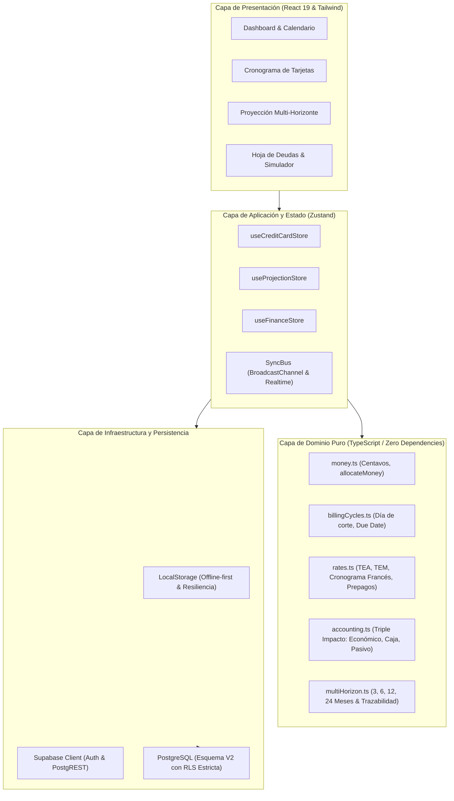

# FINANZAS 2.0 — Arquitectura del Sistema

## 1. Visión General de la Arquitectura

Finanzas 2.0.0 adopta una arquitectura desacoplada basada en capas, separando el **dominio financiero puro** (inmutable, testeable, sin dependencias de frameworks) del **estado reactivo de la aplicación** (Zustand), los **servicios de sincronización e infraestructura** (Supabase, WebSockets, LocalStorage) y la **capa de presentación** (React 19, TailwindCSS, Recharts).

---

## 2. Principios Arquitectónicos Fundamentales

### 2.1 Dominio Puro y Cero Dependencias
Toda la lógica contable, financiera y de calendario reside en `src/domain/`.
- No importa React, ni Zustand, ni Supabase.
- Opera con números finitos enteros o centavos escalados (`minorUnits`) para prevenir errores de punto flotante de IEEE 754.
- 100% testeable con pruebas unitarias deterministas que se ejecutan en milisegundos.

### 2.2 Principio del Triple Impacto Contable (Evitar Duplicación de Gasto)
Una de las debilidades comunes en aplicaciones financieras personales es computar dos veces el gasto de una compra con tarjeta:
1. Cuando se compra el producto (ej. S/ 500 en supermercado).
2. Cuando se paga el estado de cuenta a fin de mes (ej. S/ 500 al banco).

En Finanzas 2.0, `src/domain/finance/accounting.ts` implementa el desglose formal de tres vectores por movimiento:

$$\text{Impacto Total} = (\Delta \text{Económico}, \Delta \text{Caja}, \Delta \text{Pasivo})$$

| Tipo de Transacción | Impacto Económico (P&L / Presupuesto) | Impacto de Tesorería (Caja Líquida) | Impacto de Pasivo (Deuda Tarjeta) | Explicación |
|---------------------|--------------------------------------|-------------------------------------|-----------------------------------|-------------|
| **Compra con Tarjeta** | **- S/ 500** (Gasto consumido) | **S/ 0** (No sale efectivo hoy) | **+ S/ 500** (Nace obligación con banco) | El gasto se reconoce al devengarse la compra. |
| **Pago de Tarjeta** | **S/ 0** (No es un nuevo gasto) | **- S/ 500** (Sale de cuenta bancaria) | **- S/ 500** (Cancela deuda de tarjeta) | Transferencia patrimonial: cancela el pasivo sin duplicar gasto. |
| **Gasto en Efectivo/Débito** | **- S/ 100** (Gasto) | **- S/ 100** (Sale efectivo) | **S/ 0** (Sin deuda) | Salida directa de caja y gasto inmediato. |
| **Ingreso / Sueldo** | **+ S/ 5,000** (Ingreso) | **+ S/ 5,000** (Entra efectivo) | **S/ 0** | Entrada neta de tesorería y patrimonio. |
| **Interés de Tarjeta** | **- S/ 25** (Gasto financiero) | **S/ 0** (Se añade al extracto) | **+ S/ 25** (Incrementa deuda) | Costo financiero facturado por el emisor. |

---

## 3. Fuente Única de Verdad para Tarjetas de Crédito

Se eliminaron las definiciones dispersas y valores 'hardcodeados' de las tarjetas. El catálogo centralizado opera bajo la siguiente jerarquía:

1. **Memoria y Zustand (`useCreditCardStore`):**
   - Tarjetas predeterminadas reconocidas:
     - `Interbank Amex`: Día de corte 21, día límite de pago 15.
     - `BBVA Bfree`: Día de corte 10, día límite de pago 5.
     - `Ripley`: Día de corte 3, día límite de pago 1.
2. **Normalización Defensiva (`normalizeCardConfig`):**
   - Asegura rangos válidos de días (1 a 31).
   - Impide que una sincronización vacía o corrupta borre la configuración del usuario.
   - Preserva metadatos bancarios (TCEA, tasa efectiva, línea de crédito, moneda).
3. **Módulo de Proyecciones (`projectionStore.ts`):**
   - Resuelve dinámicamente las reglas consultando `useCreditCardStore.getState().getCardByEntity(entity)` mediante `resolveCardRule(entity)`.

---

## 4. Persistencia Híbrida y Sincronización en Tiempo Real

- **Offline-First:** Cada cambio en tarjetas, deudas o proyecciones se persiste inmediatamente en `localStorage`. La aplicación funciona 100% desconectada.
- **Sincronización Bidireccional:** A través de `syncBus.ts`, los cambios se transmiten entre pestañas del navegador mediante `BroadcastChannel` y entre dispositivos (móvil/web) mediante el canal WebSocket de Supabase en menos de 100 ms.
- **Seguridad en Reposo y Tránsito:** La capa de Supabase implementa aislamiento por propietario (`owner_id`) mediante Row Level Security.
