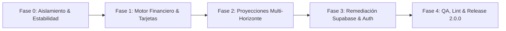

# FINANZAS 2.0 — Plan de Implementación y Hoja de Ruta

## 1. Estructura de Fases

El despliegue de Finanzas 2.0.0 sigue una metodología estricta por fases para proteger los datos financieros en producción y garantizar la estabilidad del software.

---

## 2. Detalle de Ejecución por Fase

### Fase 0: Estabilidad, Aislamiento y Build Reproducible (Completada al 100%)
- [x] Retiro de credenciales de indexación Git y actualización de `.gitignore`.
- [x] Configuración de `vitest.config.ts` con entorno `jsdom` y mock universal de Supabase para evitar ejecuciones destructivas en pruebas locales.
- [x] Desacople de pruebas de integración en `vitest.integration.config.ts`.
- [x] Modificación de `vite.config.ts` para emitir `version.json` en memoria durante `generateBundle` sin ensuciar el repositorio con archivos versionados.
- [x] Validación de build limpio con `npm run build` y validación de tipos con `npx tsc --noEmit`.

### Fase 1: Motor Financiero Puro y Unificación de Tarjetas (Completada al 100%)
- [x] Creación del módulo de centavos y distribución equitativa de cuotas (`src/domain/finance/money.ts`).
- [x] Implementación de reglas puras de ciclo de corte y fechas de vencimiento (`src/domain/cards/billingCycles.ts`).
- [x] Implementación de conversión de tasas (TEA $\leftrightarrow$ TEM), amortización francesa y simulación de prepagos (`src/domain/finance/rates.ts`).
- [x] Implementación del clasificador de triple impacto contable para evitar duplicación de gastos en compras vs. pagos de tarjeta (`src/domain/finance/accounting.ts`).
- [x] Normalización defensiva de tarjetas en `src/store/creditCardStore.ts` y consumo autoritativo desde `src/store/projectionStore.ts`.
- [x] Pruebas unitarias de cobertura total para la capa de dominio.

### Fase 2: Proyecciones Multi-Horizonte y Simulaciones (Completada al 100%)
- [x] Creación del motor multi-horizonte a 3, 6, 12 y 24 meses (`src/domain/projections/multiHorizon.ts`).
- [x] Segmentación estricta de cubetas: histórico ejecutado, obligaciones confirmadas, gastos futuros estimados y simulaciones hipotéticas.
- [x] Trazabilidad completa por partida, fecha de vencimiento y categoría.
- [x] Integración de `getMultiHorizon` en `useProjectionStore`.
- [x] Pruebas unitarias de simulación que comprueban que las compras hipotéticas no mutan los datos reales del usuario.

### Fase 3: Seguridad de Supabase y Control de Acceso (Preparada localmente — Pendiente de Aprobación para Producción)
- [x] Verificación de la tabla `public.transacciones` y confirmación de los 2,246 registros expuestos.
- [x] Documentación exhaustiva del incidente en `docs/FINANZAS_V2_SEGURIDAD_SUPABASE.md`.
- [x] Redacción del esquema complementario aditivo V2 en `supabase/migrations/20261022151306_finanzas_v2_secure_schema.sql`.
- [ ] **Acción de Producción requerida:** Autorización del usuario para ejecutar el respaldo lógico de las 2,246 filas.
- [ ] **Acción de Producción requerida:** Registro o confirmación de la cuenta del propietario en Supabase Auth (`auth.users`).
- [ ] **Acción de Producción requerida:** Ejecución de la migración de asignación de `user_id` y revocación definitiva de permisos `ALL` sobre el rol `anon`.

### Fase 4: Limpieza Progresiva de Calidad, Linting y Release (En curso)
- [x] Eliminación de 44 errores de escapes innecesarios (`no-useless-escape`).
- [x] Eliminación de 30 errores de bloques vacíos (`no-empty`).
- [x] Corrección de variables no reasignadas (`prefer-const`) y variables no utilizadas.
- [x] Reducción de la deuda técnica de lint de 352 a 180 problemas en `src/`.
- [x] Preparación del documento de release y pull request de la versión 2.0.0.
