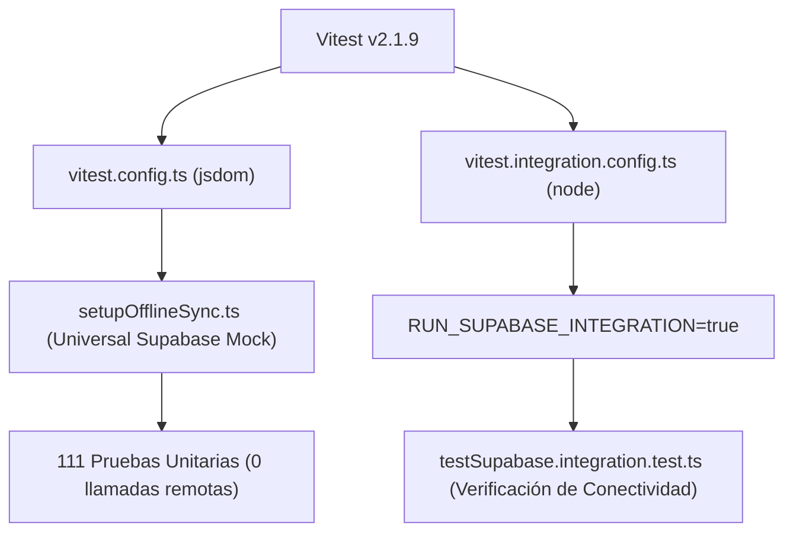

# FINANZAS 2.0 — Estrategia y Reporte de Pruebas Automatizadas

## 1. Arquitectura del Entorno de Pruebas

Para garantizar la fiabilidad del sistema sin comprometer datos reales en la nube, se reestructuró la suite de pruebas con dos entornos aislados:

---

## 2. Resumen de Ejecución y Métricas

| Métrica | Valor Obtenido | Estado |
|---------|----------------|--------|
| **Archivos de prueba unitaria** | **22 suites** | **100% aprobadas** |
| **Pruebas unitarias ejecutadas** | **111 tests** | **100% aprobadas** |
| **Pruebas fallidas** | **0** | Ningún fallo |
| **Pruebas omitidas** | **0** | Ninguna prueba silenciada |
| **Tiempo total de ejecución suite unitaria** | **~7.5 segundos** | Alto rendimiento |
| **Pruebas de integración remota** | **1 suite (1 test)** | Aprobada (solo lectura, 1.2s) |

---

## 3. Desglose de Pruebas por Módulos

### 3.1 Capa de Dominio Financiero Puro (`src/domain/__tests__/`)
- `money.test.ts` (3 tests): Conversión a enteros en unidades menores, redondeo con epsilon, asignación de centavos con `allocateMoney`.
- `billingCycles.test.ts` (7 tests): Asignación de consumos antes y después del corte, ajuste de fines de semana, años bisiestos y cruces de año.
- `rates.test.ts` (6 tests): Conversión biunívoca TEA $\leftrightarrow$ TEM, método francés sin pérdida de centavos, simulación de prepagos con ahorro de intereses.
- `accounting.test.ts` (4 tests): Clasificación del triple impacto contable, no duplicación de gasto en pagos de tarjeta, agregación de movimientos combinados.
- `multiHorizon.test.ts` (2 tests): Generación de listas de meses para 3, 6, 12 y 24 meses; separación estricta en 4 cubetas (histórico, obligaciones, estimados, simulaciones).

### 3.2 Capa de Aplicación y Stores (`src/utils/__tests__/` & `src/store/`)
- `creditCardStore.test.ts` (5 tests): Carga y normalización defensiva de tarjetas, protección de fechas ante datos externos no confirmados.
- `creditCardCycles.test.ts` (5 tests): Cálculo de fechas de ciclo para Interbank, BBVA y Ripley.
- `creditCardInstallments.test.ts` (5 tests): División de compras en cuotas con fechas de vencimiento precisas.
- `multiHorizonStore.test.ts` (2 tests): Evaluación de horizontes 3, 6, 12, 24 meses y simulaciones hipotéticas sin mutar el store real.
- `casualProjections.test.tsx` (7 tests): Flujo de proyecciones provisionales y retorno a pendientes.
- `settingsSync.test.tsx` (9 tests): Sincronización reactiva de configuraciones entre dispositivos.
- `settingsSnapshot.test.ts` (3 tests): Creación y restauración de instantáneas de configuración.
- `transactionOutbox.test.ts` (3 tests): Cola de transacciones fuera de línea para sincronización resiliente.
- `laborBenefits.test.tsx` (9 tests): Cálculos de beneficios laborales (gratificaciones, CTS, liquidaciones).
- `debtSimulator.test.tsx` (3 tests): Simulación de avalancha y bola de nieve en deudas.
- `budgetModes.test.tsx` (3 tests): Modos de presupuesto y metas de ahorro.
- `prevMonthBridge.test.ts` (9 tests): Puente contable entre saldos del mes anterior y mes actual.
- `statementParser.test.ts` (6 tests): Extracción de información de estados de cuenta PDF/texto.
- `categoryClassification.test.ts` (6 tests): Clasificación automática por palabras clave y conceptos.
- `financialInsights.test.ts` (4 tests): Detección de patrones y alertas de gasto.
- `debtScheduleDates.test.ts` (4 tests): Validación de fechas en cronogramas de amortización.

### 3.3 Capa de UI y Renderizado de Páginas
- `pagesRender.test.tsx` (6 tests):
  - Verifica el renderizado sin excepciones de las 7 vistas principales de la aplicación:
    1. Dashboard Principal
    2. Clasificación de Movimientos
    3. Cronograma de Pagos de Tarjetas
    4. Hoja de Deudas
    5. Proyección Financiera
    6. Registro de Movimientos
    7. Dashboards Analíticos

### 3.4 Capa de Integración
- `testSupabase.integration.test.ts` (1 test):
  - Verifica conectividad de solo lectura contra Supabase.
  - Comprueba la existencia de la tabla y la cuenta de registros sin modificar el servidor remoto.
