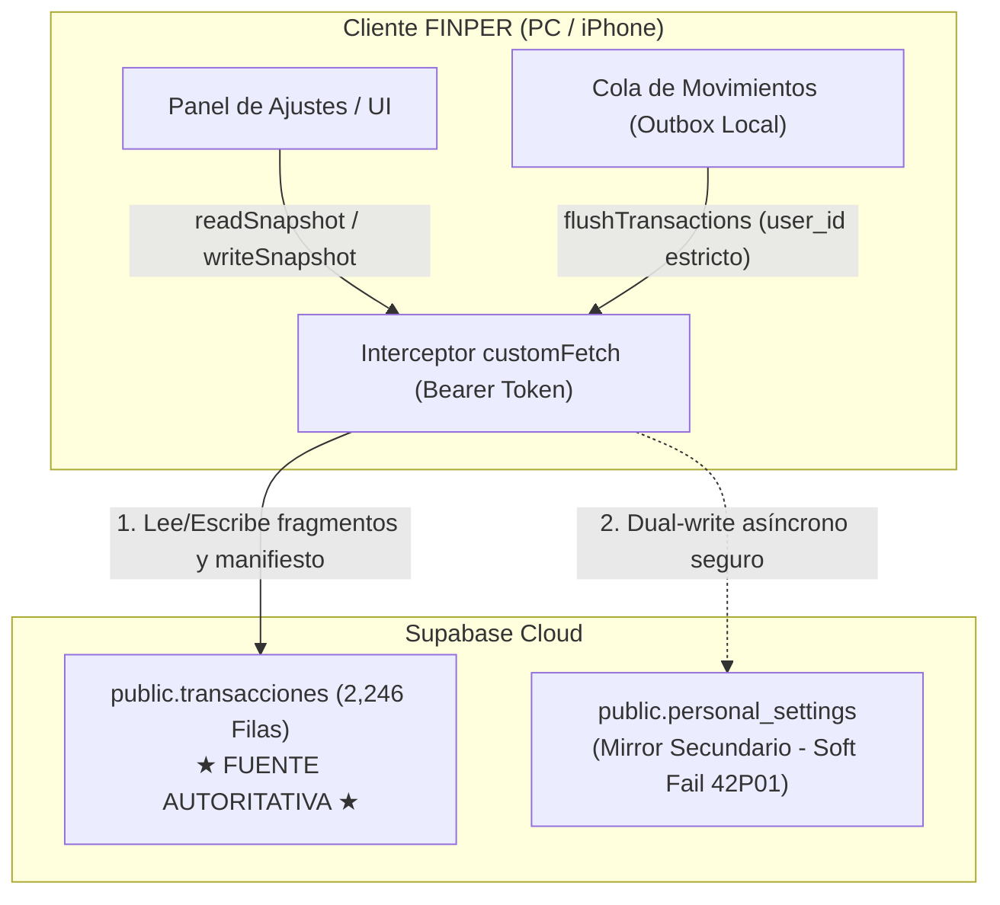

# FINPER 2.0.2 — Protocolo de Recuperación de Sincronización y Resiliencia RLS

**Versión:** 2.0.2  
**Fecha:** 22 de Octubre de 2026  
**Rama:** `fix/finper-v202-sync-recovery`  
**Objetivo:** Restaurar la sincronización fluida y bidireccional de movimientos y configuraciones entre PC y iPhone, resolviendo bloqueos por permisos RLS, previniendo condiciones de carrera y preservando intactos los 2,246 registros históricos en Supabase.

---

## 1. Arquitectura de Almacenamiento y Jerarquía de Fuentes de Verdad

Debido a que la tabla dedicada `public.personal_settings` aún no ha sido aprovisionada en el Supabase de producción (retornando error Postgres `42P01: relation does not exist`), FINPER 2.0.2 establece una jerarquía formal y determinista:



### Reglas de Operación:
1. **`public.transacciones` es la única fuente de verdad autoritativa:** Todos los fragmentos (`config-sync-<name>-<uuid>-<index>`) y manifiestos (`config-sync-<name>`) se leen y validan obligatoriamente contra `transacciones`.
2. **`personal_settings` opera como mirror secundario tolerante a fallos:** Las lecturas y escrituras hacia `personal_settings` capturan de forma no destructiva los errores `42P01` (tabla inexistente) o de permisos, permitiendo que la aplicación continúe funcionando al 100% de manera transparente.
3. **Token de Concurrencia Homogéneo:** `readSnapshot()` retorna siempre como token de concurrencia (`head`) la cadena exacta almacenada en `transacciones.concepto`. Con esto se erradica el error de falso conflicto concurrente provocado por tokens sintéticos.

---

## 2. Inyección Resiliente de Autenticación (`customFetch`)

Para solucionar el error Postgres `42501` (Permission Denied) provocado cuando el cliente SDK de Supabase emitía consultas antes de que su estado GoTrue en memoria estuviera completamente inicializado, se implementó un interceptor a nivel de transporte HTTP en `src/lib/supabase.ts`:

```typescript
const customFetch: typeof fetch = async (input, init) => {
  const headers = new Headers(init?.headers);
  const currentAuth = headers.get('Authorization');
  const token = getStoredAccessToken();

  const urlStr = typeof input === 'string' ? input : (input instanceof Request ? input.url : '');

  // Garantizar que toda consulta a la base de datos (/rest/v1/) lleve el Bearer token del usuario
  if (token && urlStr.includes('/rest/v1/')) {
    if (!currentAuth || currentAuth === `Bearer ${SUPABASE_PUBLISHABLE_KEY}` || currentAuth.includes('anon')) {
      headers.set('Authorization', `Bearer ${token}`);
    }
  } else if (token && (!currentAuth || currentAuth === `Bearer ${SUPABASE_PUBLISHABLE_KEY}`)) {
    headers.set('Authorization', `Bearer ${token}`);
  }

  return fetch(input, { ...init, headers });
};
```

### Beneficios Técnicos:
- **Zero RLS 42501:** Ninguna consulta a `transacciones` se envía con el rol `anon` si existe una sesión válida localmente.
- **Protección de endpoints de Auth:** Las rutas `/auth/v1/` continúan empleando la clave pública/anónima según lo requerido por el protocolo OAuth/GoTrue para inicios de sesión y refresco.
- **Multiplataforma:** Opera idénticamente en navegadores de escritorio (Chrome, Edge, Firefox) y dispositivos móviles (Safari iOS, PWA).

---

## 3. Desagregación del Diagnóstico de Sesión (`getAuthDiagnostic`)

FINPER 2.0.2 reemplaza la evaluación binaria superficial de sesión por un modelo de 6 estados granulares:

| Estado de Verificación | Descripción | Representación en UI |
| :--- | :--- | :--- |
| `server_verified` | Confirmado en tiempo real con Supabase (`auth.getUser()`). | **Validada en Supabase** (Verde) |
| `offline_cached` | Sesión local válida, pero el dispositivo no tiene acceso a internet. | **Offline (Caché local)** (Ámbar) |
| `local_recoverable` | Token recuperado de almacenamiento, pendiente de validación en servidor. | **Sesión local (Verificando…)** (Celeste) |
| `sdk_active` | Sesión activa en memoria del cliente GoTrue. | **Activa en SDK** (Verde esmeralda) |
| `expired` | Token expirado; se requiere renovación o nuevo inicio de sesión. | **Sesión expirada** (Rojo) |
| `unauthenticated` | No se encontró sesión local ni remota. | **Sin autenticar** (Gris) |

Esto elimina la discrepancia donde la interfaz aseguraba que la sesión estaba *"Validada en Supabase"* sin haber realizado una verificación real contra el servidor.

---

## 4. Recuperación Idempotente contra Claves Duplicadas (Postgres 23505)

Cuando un cliente sincroniza por primera vez un módulo cuyo manifiesto ya existía previamente en Supabase, `previousHead` es `null`. 

FINPER 2.0.2 intercepta la colisión de clave primaria y la transforma en una actualización transparente:

```typescript
if (previousHead === null) {
  const { error: insertErr } = await supabase.from('transacciones').insert(row(id, head, 0, userId));
  if (insertErr) {
    if (insertErr.code === '23505' || insertErr.message?.toLowerCase().includes('duplicate key')) {
      // Fila preexistente: conmutar a actualización idempotente
      const { error: updateErr } = await supabase
        .from('transacciones')
        .update({ concepto: head })
        .eq('id', id);
      if (updateErr) throw updateErr;
    } else {
      throw insertErr;
    }
  }
}
```

---

## 5. Protocolo de Protección del Outbox de Movimientos

Para resolver el problema de las **4 transacciones pendientes en cola** en la PC:

1. **Titularidad Forzada:** `insertTransactionToSupabase()` y `deleteTransactionFromSupabase()` verifican la sesión y adjuntan obligatoriamente el `user_id` del usuario autenticado. Si no hay sesión, rechazan la operación sin descartar el elemento de la cola.
2. **Reintento Idempotente:** `flushTransactions()` itera la cola de movimientos. Si la inserción tiene éxito en Supabase (ahora permitida por la inyección del Bearer token), el elemento se retira de la cola y se emite la sincronización en tiempo real vía `broadcastRealtimeSync('transactions')`.
3. **Cero Pérdida de Datos:** En caso de corte de red o error temporal, las transacciones permanecen intactas en `localStorage` (`finper_transaction_outbox_v1`) y en memoria hasta su confirmación exitosa en Supabase.
