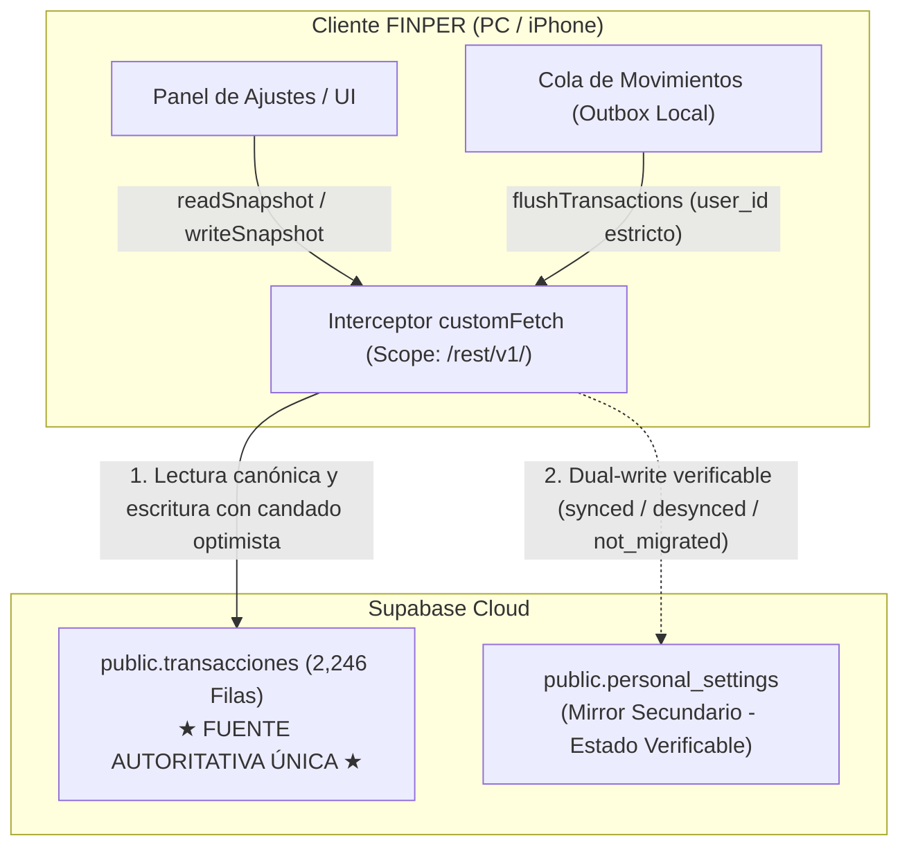

# FINPER 2.0.2 — Protocolo de Recuperación de Sincronización y Resiliencia RLS

**Versión:** 2.0.2  
**Fecha:** 22 de Octubre de 2026  
**Rama:** `fix/finper-v202-sync-recovery`  
**Objetivo:** Restaurar la sincronización fluida y bidireccional de movimientos y configuraciones entre PC y iPhone, resolviendo bloqueos por permisos RLS, previniendo condiciones de carrera y sobrescrituras ciegas, y preservando intactos los 2,246 registros históricos en Supabase.

---

## 1. Arquitectura de Almacenamiento y Definición de Fuente Autoritativa

FINPER 2.0.2 establece formalmente que **`public.transacciones` es la ÚNICA FUENTE DE VERDAD AUTORITATIVA (Single Source of Truth)**. La tabla `personal_settings` opera como un mirror secundario y de contingencia para la futura migración.



### Reglas de Operación:
1. **Lectura canónica estricta:** `readSnapshot()` consulta siempre `transacciones`. Si el registro y sus fragmentos están íntegros, devuelve ese valor autoritativo. Nunca permite que una versión desfasada de la tabla secundaria sustituya la versión autoritativa.
2. **Rescate ante contingencia:** Únicamente si `transacciones` se encuentra vacío o con fragmentos dañados, se acude a `personal_settings` como mecanismo de rescate.
3. **Mirror secundario con estado verificable:** Toda escritura en `personal_settings` registra su estado:
   - `table_not_migrated`: Si Supabase responde `42P01` (tabla no aprovisionada aún).
   - `synced`: Si la persistencia secundaria se confirmó exitosamente.
   - `desynced`: Si la tabla existe pero la escritura secundaria falló, registrando el error técnico sin interrumpir el flujo principal.
4. **Reconciliación a demanda:** Se exporta `repairMirrorSync(name)` para sincronizar bajo demanda la tabla secundaria desde la fuente autoritativa en cualquier momento.

---

## 2. Eliminación de Sobrescritura Ciega ante Colisión 23505

En versiones anteriores, si dos dispositivos intentaban una inserción simultánea con `previousHead = null`, el segundo en llegar capturaba el error `23505` (clave duplicada) y ejecutaba un `UPDATE` sin comprobar la versión existente, sobreescribiendo los datos del primer dispositivo.

### Solución en FINPER 2.0.2:
```typescript
if (previousHead === null) {
  const { error: insertErr } = await supabase.from('transacciones').insert(row(id, head, 0, userId));
  if (insertErr) {
    // Si la fila ya existe, NUNCA sobreescribir sin versión previa
    if (
      insertErr.code === '23505' ||
      insertErr.message?.toLowerCase().includes('duplicate key') ||
      insertErr.message?.toLowerCase().includes('unique')
    ) {
      throw new Error('Otro dispositivo actualizó los datos. Reintenta para comparar las versiones.');
    }
    throw insertErr;
  }
} else {
  // Comprobación estricta de concurrencia optimista
  const result = await supabase
    .from('transacciones')
    .update({ concepto: head })
    .eq('id', id)
    .eq('concepto', previousHead)
    .select('id');

  if (result.error) throw result.error;
  if (!result.data?.length) {
    throw new Error('Otro dispositivo actualizó los datos. Reintenta para comparar las versiones.');
  }
}
```

**Garantía:** Ningún dispositivo puede sobreescribir ajustes de otro sin detectar el cambio concurrente y forzar la comparación visual de versiones.

---

## 3. Interceptor HTTP Acotado y Sincronizado con el SDK (`customFetch`)

Para resolver los errores RLS `42501` sin alterar el ciclo de vida del SDK ni intervenir endpoints ajenos:

1. **Alcance Estricto:** Interviene **exclusivamente** peticiones a `/rest/v1/` (PostgREST). Las rutas `/auth/v1/` (login, refresh, signup), almacenamiento y APIs externas pasan directamente sin ser interceptadas.
2. **Respeto a la Sesión del SDK:** Si la petición ya lleva un `Bearer` token asignado por el SDK, el interceptor no lo reemplaza ni modifica.
3. **Sincronización Reactiva:** El token en memoria se actualiza en tiempo real suscribiéndose al evento oficial `supabase.auth.onAuthStateChange`, garantizando que la renovación de tokens (`TOKEN_REFRESHED`) sea inmediata.

---

## 4. Desagregación del Diagnóstico de Sesión (`getAuthDiagnostic`)

FINPER 2.0.2 implementa un modelo de 6 estados:

| Estado de Verificación | Descripción | Representación en UI |
| :--- | :--- | :--- |
| `server_verified` | Confirmado en tiempo real con Supabase (`auth.getUser()`). | **Validada en Supabase** (Verde) |
| `offline_cached` | Sesión local válida, pero el dispositivo no tiene acceso a internet. | **Offline (Caché local)** (Ámbar) |
| `local_recoverable` | Token recuperado de almacenamiento, pendiente de validación en servidor. | **Sesión local (Verificando…)** (Celeste) |
| `sdk_active` | Sesión activa en memoria del cliente GoTrue. | **Activa en SDK** (Verde esmeralda) |
| `expired` | Token expirado; se requiere renovación o nuevo inicio de sesión. | **Sesión expirada** (Rojo) |
| `unauthenticated` | No se encontró sesión local ni remota. | **Sin autenticar** (Gris) |

La UI **solo muestra «Validada en Supabase»** si el servidor confirmó la sesión en tiempo real.

---

## 5. Protocolo de Protección del Outbox de Movimientos

1. **Titularidad Forzada:** `insertTransactionToSupabase()` y `deleteTransactionFromSupabase()` verifican la sesión y adjuntan obligatoriamente el `user_id` del usuario autenticado. Si no hay sesión, rechazan la operación sin descartar el elemento de la cola.
2. **Despacho Idempotente:** `flushTransactions()` despacha la cola de movimientos hacia Supabase con el Bearer token inyectado. Al confirmarse el éxito, el elemento se retira y se emite la sincronización en tiempo real vía `broadcastRealtimeSync('transactions')`.
3. **Cero Pérdida de Datos:** Si ocurre un corte de red, las operaciones se retienen intactas en `localStorage` (`finper_transaction_outbox_v1`) y se reintentan automáticamente al restablecerse la conexión.
