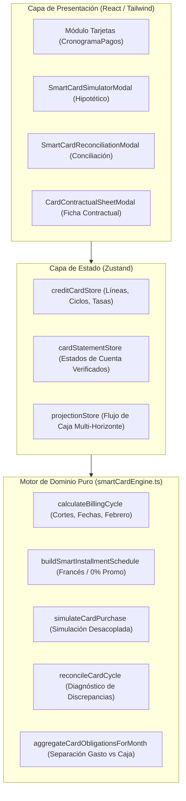

# FINPER 2.1 — SPRINT 01: ARQUITECTURA DE TARJETAS INTELIGENTES

**Versión:** 2.1.0-sprint01  
**Rama:** `feature/finper-v21-smart-cards-sprint01`  
**Estado:** Implementado, validado y probado (209 pruebas aprobadas)

---

## 1. Visión General del Dominio

El módulo de **Tarjetas Inteligentes** unifica el ciclo de vida del crédito de consumo bajo una arquitectura pura e inmutable, separando estrictamente:
- **El Hecho Económico (Devengado):** Consumo realizado en la fecha de compra con tarjeta de crédito (imputación presupuestaria al rubro correspondiente).
- **El Desembolso Financiero (Caja):** Cancelación del estado de cuenta o pago de cuotas en la fecha límite de pago (cancelación de pasivo / flujo de caja).
- **La Obligación Contractual:** Líneas de crédito autorizadas, tasas efectivas (TEA/TEM), seguro de desgravamen, comisiones y reglas de corte/vencimiento.

---

## 2. Los 4 Estados Financieros de FINPER 2.1

Para garantizar máxima transparencia y evitar asunciones indebidas, cada cifra en FINPER 2.1 se clasifica en uno de cuatro estados:

1. **`confirmed` (Confirmado):** Datos verificados contra documento oficial (estado de cuenta emitido por el banco o comprobante de pago bancario).
2. **`calculated` (Calculado):** Cifras computadas automáticamente por FINPER en base a movimientos registrados y reglas de corte.
3. **`estimated` (Estimado):** Proyecciones a futuro basadas en supuestos contractuales (ej. cronograma de cuotas futuras con TEA supuesta).
4. **`hypothetical` (Hipotético):** Simulación pura interactiva ejecutada en memoria. **Jamás se persiste en base de datos ni muta saldos**.

---

## 3. Modelo de Datos de las 3 Tarjetas del Usuario

| Tarjeta | ID Estable | Emisor | Red | Línea Ref. (30/09/2026) | Deuda Usada Ref. | Corte | Pago | Regla de Ciclo |
| :--- | :--- | :--- | :--- | :--- | :--- | :--- | :--- | :--- |
| **Ripley Mastercard** | `card-ripley` | Banco Ripley | Mastercard | S/ 1,000.00 | S/ 358.66 | Día 3 | Día 1 | Compra < día 3 vence mes siguiente; >= día 3 vence en 2 meses |
| **Interbank Amex Benefit** | `card-ibk-amex` | Interbank | American Express | S/ 1,000.00 | S/ 182.38 | Día 21 | Día 15 | Compra < día 21 vence mes siguiente; >= día 21 vence en 2 meses |
| **BBVA Bfree** | `card-bbva-bfree` | BBVA Perú | Visa | S/ 700.00 | S/ 436.21 | Día 10 | Día 5 | Compra < día 10 vence mes siguiente; >= día 10 vence en 2 meses |

---

## 4. Algoritmos Clave del Motor Puro (`smartCardEngine.ts`)

### 4.1 Amortización Francesa y Cent Rounding
- Convierte TEA a TEM mediante:
  $$\text{TEM} = (1 + \text{TEA})^{1/12} - 1$$
- Calcula la cuota nivelada de capital e intereses:
  $$\text{Cuota} = P \times \frac{\text{TEM} \cdot (1 + \text{TEM})^n}{(1 + \text{TEM})^n - 1}$$
- En cada periodo aplica seguro de desgravamen sobre saldo deudor y redondeo estricto a 2 decimales (`roundMoney`).
- **Cierre exacto:** La última cuota ajusta el remanente en centavos para que el saldo final sea exactamente S/ 0.00.

### 4.2 Promociones a Cuotas Sin Intereses (0% TEA)
- Identifica promociones (ej. 3 cuotas sin intereses Ripley / BBVA).
- Distribuye el capital mediante `allocateMoney` repartiendo los centavos sobrantes en las primeras cuotas de forma determinística.
- Interés estrictamente igual a S/ 0.00.

### 4.3 Detección de Datos Contractuales Incompletos
- Si una simulación o cálculo financiado carece de TEA o seguro de desgravamen, el motor marca `isComplete: false` y adjunta:
  `CONTRACTUAL_WARNING_MESSAGE = 'Estimación incompleta: faltan datos contractuales'`.
- NUNCA inventa una tasa del 0% ni asume condiciones comerciales sin confirmación del usuario.

### 4.4 Conciliación Bancaria Asistida
- Compara `statementDebtConfirmed` vs `finperCalculatedDebt`.
- Determina varianza: $\Delta = \text{Banco} - \text{FINPER}$.
- Clasifica:
  * `CONCILIADO`: $|\Delta| \le 0.05$.
  * `DISCREPANCIA_MAYOR_BANCO`: Banco registra más (intereses no registrados, seguro de desgravamen, membresía o consumos omitidos).
  * `DISCREPANCIA_MAYOR_FINPER`: FINPER registra más (consumos duplicados, devoluciones o compras post-corte).

---

## 5. Integración con Proyecciones Multi-Horizonte (3, 6, 12, 24 meses)

Para evitar duplicidad presupuestaria:
1. Una compra en cuotas realizada con tarjeta genera un **egreso por devengado** en su fecha de compra (registrado en el módulo correspondiente).
2. En las proyecciones de caja multi-horizonte (`multiHorizon.ts`), las cuotas futuras se agrupan en el balde de **Obligaciones Confirmadas de Tarjeta** (`confirmedCardObligations`), representando el desembolso bancario en la fecha de pago.
3. No se duplica el gasto en el flujo neto disponible.
